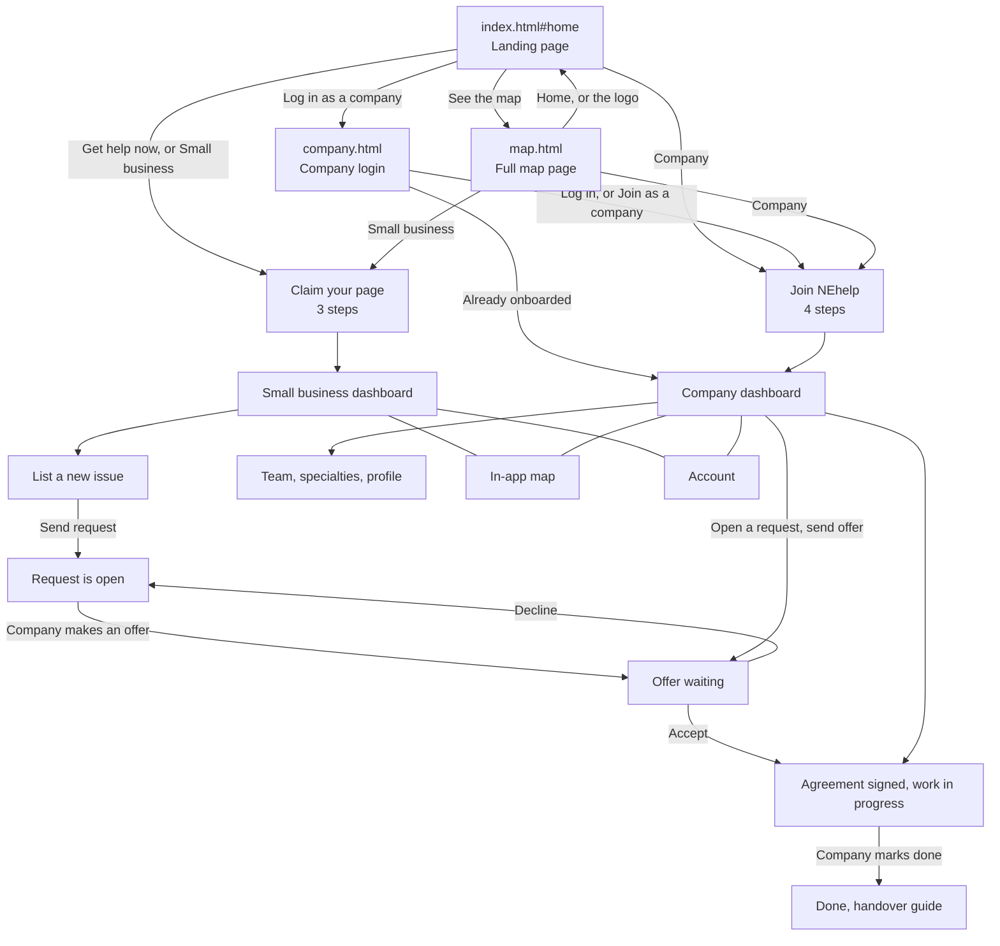

# NEhelp

Small businesses and the larger companies who can help them, in one place. "NEhelp" sounds like "any help", and it means North East help.

- **Small businesses** claim a page, say what would help in plain words, and get offers from larger companies nearby.
- **Companies** share spare time and skills, see the requests that fit their team, and make offers under a short agreement.
- **A map** shows local businesses and who is already on NEhelp.

**Status:** hackathon demo. Signed-up profiles, requests, offers and ratings are made up. Businesses on the map that haven't signed up are real, with names changed.

## Run it

It's plain HTML, CSS and JavaScript. There is nothing to install or build.

- Open `index.html` in a browser, or
- put the folder on any static host (GitHub Pages, Netlify, Cloudflare Pages and so on).

Fonts and the map library (Leaflet) load from the internet, and the map needs internet for its tiles. The dashboards, onboarding, offers and account pages don't need a server at all.

## Privacy: three layers

The idea behind NEhelp is that each person only sees what they should.

| Layer | Example | Who sees it |
|---|---|---|
| Public facts | Name, area, has a website? | Everyone |
| Needs the owner shares | "Wants help with taxes" | Companies and providers, only if the owner chooses to share it |
| Private guesses | "No accountant and the tax deadline is 31 January" | The owner only |

In this static demo each screen simply shows the right layer for its role. Nothing enforces it behind the scenes, so treat it as a working picture of the rule, not a security guarantee. A real version would enforce it on a server, so private data never reaches another person's browser, and a provider would never be told *which* competitor an unhappy business uses.

## Where Claude fits

In the full design, Claude does two jobs:

- **Request drafting** (**List new issue**) turns a few plain words into a clear request, which the owner checks before sending.
- **The adviser** (on `map.html`) reads an owner's profile and gives advice on every need: *sort this now*, *worth considering*, *you can skip this* or *already sorted*, each with a reason and a next step. It takes the owner's side and doesn't push paid services they don't need.

Both need a backend that holds a Claude API key, and this static version doesn't include one. Without it, request drafting falls back to a simple local draft (you'll see "Claude wasn't available, so we drafted it here"), and the adviser can't run.

## What needs a backend

Everything here is static except the parts that ask a server for data. The code still calls these addresses:

| Called from | Address | Used for |
|---|---|---|
| `app.js` | `/api/draft-request` | Claude drafting a request (falls back to a local draft) |
| `map.js` | `/api/businesses` | The businesses on the in-app map and list, and the small preview maps |
| `map-page.js` | `/api/meta`, `/api/business/<id>`, `.../needs`, `.../advise`, `/api/provider/<id>/map` | Everything on `map.html` |

On a plain static host these addresses don't exist. The in-app map and list show an error message instead of businesses, and `map.html` can't load its panels. To make the maps work without a server, the sample businesses need to be bundled with the site as a file and read from there.

## Not built yet

- Real sign-in and payments. Login is a demo and nothing is checked or charged.
- A backend. Dashboard data is saved in the browser only, so it isn't shared between people or devices.
- Claude drafting and the adviser (see above).
- Maps that work without a server (see above).
- Real checks against official sources (Companies House, Food Standards Agency hygiene ratings).
- Real messaging. The message box is a demo.
- Ratings that other small businesses can browse.

---

## Pages and files

Everything lives together in one `static/` folder, so every link between pages is a plain relative link (`map.html`, `company.html`, `index.html#home`). There are no sub-folders.

### The three pages

| Page | What it does | Who it's for |
|---|---|---|
| `index.html` | The main app. One page that swaps between screens: the landing page, claiming a business page, the small business dashboard, company onboarding, the company dashboard, the in-app map and the account page. Which screen shows is set by the part after the `#` in the address (see "Screens inside index.html"). | Everyone |
| `company.html` | Company login. In this demo the email and six-digit code are optional, so **Log in** always works. It signs the company in and sends them to onboarding (first time) or their dashboard. | Larger companies |
| `map.html` | The full map page. **I run a small business** shows one business, the private guesses only the owner sees, the needs form and the adviser. **I'm a provider** shows who wants help, with a colour-coded pin per business. Needs a backend (see "What needs a backend"). | Small businesses and providers |

All three pages share the same header (logo, **Small business** and **Company** switch, **Map** button), fonts and colours from `nehelp.css`. The logo always goes to `index.html#home`. The top bar and buttons turn **teal** on the small business side and **orange** on the company side.

### The other files

| File | What it holds |
|---|---|
| `nehelp.css` | Shared brand styles used by all three pages (colours, fonts, header, buttons, cards, dashboards). |
| `map-page.css` | Extra styles just for `map.html`. It reuses the colours from `nehelp.css`. |
| `map-page.js` | Everything `map.html` does: owner view, needs form, adviser, provider view, pins. |
| `state.js` | Demo data, saving to the browser, and small helpers shared by the other scripts. |
| `landing.js` | The landing page and the three-step "claim your business" onboarding. |
| `layout.js` | The page frame (side menu, summary panel) plus quick links, info cards and the account page. |
| `business.js` | Small business screens: overview, list a new issue, update issues, offers and companies. |
| `map.js` | The in-app map (map and list views, plus the small preview maps on the dashboards). |
| `company.js` | Company screens: four-step onboarding, overview, team, specialties, profile, account. |
| `dialogs.js` | Pop-ups: issue details and agreements, handover guide, messages, display settings, edit business, delete account. |
| `app.js` | Works out which screen to show, handles every button, and starts the app. |

`index.html` loads the scripts in this order, and they all share one global scope: `state`, `landing`, `layout`, `business`, `map`, `company`, `dialogs`, `app`.

### Screens inside `index.html`

| Address | Screen |
|---|---|
| `index.html#home` | Landing page (also shown when nobody is signed in) |
| `index.html#go-business` | Signs in as a small business and opens onboarding or the dashboard. Used by the **Small business** links on other pages. |
| `index.html#go-company` | Signs in as a company and opens onboarding or the dashboard. Used by the **Company** links on other pages. |
| `#onboarding` | Small business: claim your page, confirm it's you, check the details |
| `#b-issues` | Small business overview: status, issues, next steps, activity, companies ready to help, map preview |
| `#b-new` | List a new issue |
| `#b-map` | Map of nearby businesses, as a map or a list |
| `#b-update` | Rename issues and change their status |
| `#b-companies` | Offers waiting, companies working with you, finished jobs and handover guides |
| `#b-account` | Account: profile, notifications, business details, download or delete your data |
| `#c-onboarding` | Company: four-step "Join NEhelp" |
| `#c-requests` | Company overview: requests that fit the team, demand, capacity, activity, partner guide, map preview |
| `#c-map` | Same map as the small business side |
| `#c-add` | Add an employee |
| `#c-specialty` | Change each employee's specialty and availability |
| `#c-companies` | Businesses the company is working with |
| `#c-profile` | Company profile: areas, hours, kinds of work, membership |
| `#c-account` | Account: same as the small business account, for the company contact |

## App flow

### A small business, step by step

1. Land on `index.html#home` and press **Get help now** (or **Small business** in the header).
2. **Claim your page**: see the page we built from public information, confirm it's you (the number and code can be left blank in the demo), then check the details.
3. Land on the **dashboard**. Status cards show Finance, Marketing and Employment at a glance.
4. **List a new issue**: type or pick an idea, and a draft request is made from your words. Check it, choose free, discounted or paid, and send it.
5. Companies make offers. Under **Update company relationships** you can accept or decline. Accepting signs a short agreement.
6. When the company finishes, open the **handover guide**.
7. Along the way: **Map** shows nearby businesses, and **Account** holds your profile, notifications and your data.

### A company, step by step

1. From the landing page, **Company** in the header or **Log in as a company** (`company.html`).
2. **Join NEhelp**: company details, which areas and North East districts you cover, your team, and how you'll work (free, discounted or paid) plus the partner terms.
3. The **dashboard** shows requests that fit, with a tag saying why any don't (outside your area, no one free, and so on).
4. Open a request, pick an employee, set hours and a price, and **send an offer**. The business name stays hidden until they accept.
5. Once accepted, the job shows as in progress. **Mark done** when finished.
6. **Team** and **Update specialty** change who can be offered. **Company profile** changes areas, hours and kinds of work. **Your impact** adds up agreed work and free hours.

### The map page, step by step

This page needs a backend (see "What needs a backend").

1. Open `map.html` from **Map** in the header or **See the map** on the landing page.
2. **I run a small business**: pick a business, read the guesses only the owner sees, fill in the needs form (tick **Show providers** to share a need) and press **What do I actually need?** for the adviser.
3. **I'm a provider**: pick a company to see its colour-coded pins and the list of businesses, best leads first.
4. Use **Home**, **Company login**, the **Small business** and **Company** links, or the logo to go back to the app.

### Where the data lives

- **In the browser** (`localStorage`, key `nehelp-v3`): the small business and company dashboards, requests, offers, employees and accounts. **Reset demo data** in the avatar menu clears it, and **Delete my account** does the same.
- **From a server** (not included in this static version): the businesses on the maps and everything on `map.html`. See "What needs a backend" for the exact addresses.
- The dashboards and `map.html` use separate demo data for now, so a request sent from a dashboard won't show up as a pin on `map.html` yet.

## Credits

- Food hygiene ratings: Food Standards Agency, Open Government Licence v3.0.
- Business data on the map: © OpenStreetMap contributors (ODbL).
- Maps: [Leaflet](https://leafletjs.com/).
