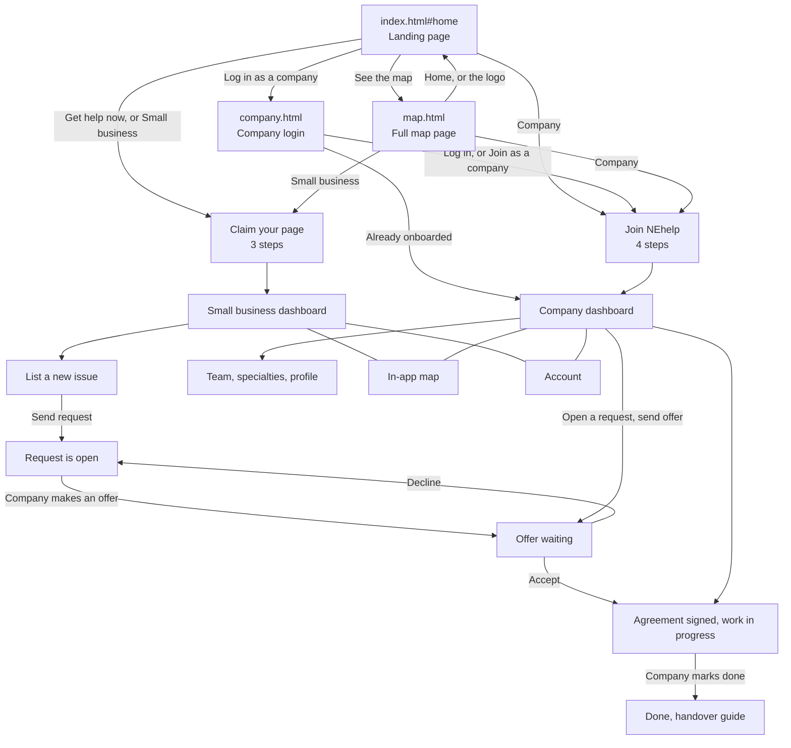

# NEhelp

A map that connects small businesses with the providers who can help them.

- **Small businesses** sign up cheaply, list what they use and how happy they are, and get honest advice from Claude about what they actually need, including what they can skip.
- **Providers** (banks, card payment firms, accountants, marketing agencies) pay to see who wants help, who has no provider and which of their own customers are happy.

**Status:** hackathon demo. All data is made up (see `data/sample_data.json`).

## Privacy: three layers

| Layer | Example | Who sees it |
|---|---|---|
| Public facts | Name, area, has a website? | Everyone |
| Needs the owner shares | "Wants help with taxes" | Providers, only if the owner ticks **Show providers** |
| Private guesses | "No accountant and the tax deadline is 31 January" | The owner only |

The server enforces this in `app.py` (`public_view`, `provider_view`, `match_for`), so private data never reaches a provider's browser. A provider is also never told *which* competitor an unhappy business uses.

## How Claude is used

The **adviser** (`/api/business/<id>/advise`) sends the owner's profile to Claude Opus 5.5 and gets back structured advice for every need: *sort this now*, *worth considering*, *you can skip this* or *already sorted*, each with a reason and a next step. It's told to take the owner's side and not push paid services they don't need.

## Run it

You need [uv](https://docs.astral.sh/uv/) (`brew install uv`).

```sh
cp .env.example .env      # then paste your Claude API key into .env
uv run app.py
```

Open http://127.0.0.1:5050. The map and both views work without a key. Only the adviser needs one.

## Not built yet

- Logins and payments. Anyone can open any owner view in this demo.
- Ratings that other small businesses can browse.
- Real data from official sources (FSA hygiene ratings, Companies House).
- Messaging between providers and businesses.
- Saving changes. Edits are kept in memory and reset when the server restarts.

---

## Pages and files

Everything lives together in one `static/` folder, so every link between pages is a plain relative link (`map.html`, `company.html`, `index.html#home`). There are no sub-folders.

### The three pages

| Page | What it does | Who it's for |
|---|---|---|
| `index.html` | The main app. One page that swaps between screens: the landing page, claiming a business page, the small business dashboard, company onboarding, the company dashboard, the in-app map and the account page. Which screen shows is set by the part after the `#` in the address (see "Screens inside index.html"). | Everyone |
| `company.html` | Company login. In this demo the email and six-digit code are optional, so **Log in** always works. It signs the company in and sends them to onboarding (first time) or their dashboard. | Larger companies |
| `map.html` | The full map page. **I run a small business** shows one business, the private guesses only the owner sees, the needs form and the Claude adviser. **I'm a provider** shows who wants help, with a colour-coded pin per business. Talks to the server (`/api/...`). | Small businesses and providers |

All three pages share the same header (logo, **Small business** and **Company** switch, **Map** button), fonts and colours from `nehelp.css`. The logo always goes to `index.html#home`. The top bar and buttons turn **teal** on the small business side and **orange** on the company side.

### The other files

| File | What it holds |
|---|---|
| `nehelp.css` | Shared brand styles used by all three pages (colours, fonts, header, buttons, cards, dashboards). |
| `map-page.css` | Extra styles just for `map.html`. It reuses the colours from `nehelp.css`. |
| `map-page.js` | Everything `map.html` does: owner view, needs form, adviser, provider view, pins. |
| `state.js` | Demo data, saving to the browser, and small helpers shared by the other scripts. |
| `landing.js` | The landing page and the three-step "claim your business" onboarding. |
| `layout.js` | The page frame (side menu, summary panel) plus quick links, info cards and the account page. |
| `business.js` | Small business screens: overview, list a new issue, update issues, offers and companies. |
| `map.js` | The in-app map (map and list views, plus the small preview maps on the dashboards). |
| `company.js` | Company screens: four-step onboarding, overview, team, specialties, profile, account. |
| `dialogs.js` | Pop-ups: issue details and agreements, handover guide, messages, display settings, edit business, delete account. |
| `app.js` | Works out which screen to show, handles every button, and starts the app. |

`index.html` loads the scripts in this order, and they all share one global scope: `state`, `landing`, `layout`, `business`, `map`, `company`, `dialogs`, `app`.

### Screens inside `index.html`

| Address | Screen |
|---|---|
| `index.html#home` | Landing page (also shown when nobody is signed in) |
| `index.html#go-business` | Signs in as a small business and opens onboarding or the dashboard. Used by the **Small business** links on other pages. |
| `index.html#go-company` | Signs in as a company and opens onboarding or the dashboard. Used by the **Company** links on other pages. |
| `#onboarding` | Small business: claim your page, confirm it's you, check the details |
| `#b-issues` | Small business overview: status, issues, next steps, activity, companies ready to help, map preview |
| `#b-new` | List a new issue (Claude turns your words into a request) |
| `#b-map` | Map of nearby businesses, as a map or a list |
| `#b-update` | Rename issues and change their status |
| `#b-companies` | Offers waiting, companies working with you, finished jobs and handover guides |
| `#b-account` | Account: profile, notifications, business details, download or delete your data |
| `#c-onboarding` | Company: four-step "Join NEhelp" |
| `#c-requests` | Company overview: requests that fit the team, demand, capacity, activity, partner guide, map preview |
| `#c-map` | Same map as the small business side |
| `#c-add` | Add an employee |
| `#c-specialty` | Change each employee's specialty and availability |
| `#c-companies` | Businesses the company is working with |
| `#c-profile` | Company profile: areas, hours, kinds of work, membership |
| `#c-account` | Account: same as the small business account, for the company contact |

## App flow



### A small business, step by step

1. Land on `index.html#home` and press **Get help now** (or **Small business** in the header).
2. **Claim your page**: see the page we built from public information, confirm it's you (the number and code can be left blank in the demo), then check the details.
3. Land on the **dashboard**. Status cards show Finance, Marketing and Employment at a glance.
4. **List a new issue**: type or pick an idea, and Claude drafts a clear request (a simple local draft is used if the server isn't running). Check it, choose free, discounted or paid, and send it.
5. Companies make offers. Under **Update company relationships** you can accept or decline. Accepting signs a short agreement.
6. When the company finishes, open the **handover guide**.
7. Along the way: **Map** shows nearby businesses, and **Account** holds your profile, notifications and your data.

### A company, step by step

1. From the landing page, **Company** in the header or **Log in as a company** (`company.html`).
2. **Join NEhelp**: company details, which areas and North East districts you cover, your team, and how you'll work (free, discounted or paid) plus the partner terms.
3. The **dashboard** shows requests that fit, with a tag saying why any don't (outside your area, no one free, and so on).
4. Open a request, pick an employee, set hours and a price, and **send an offer**. The business name stays hidden until they accept.
5. Once accepted, the job shows as in progress. **Mark done** when finished.
6. **Team** and **Update specialty** change who can be offered. **Company profile** changes areas, hours and kinds of work. **Your impact** adds up agreed work and free hours.

### The map page, step by step

1. Open `map.html` from **Map** in the header or **See the map** on the landing page.
2. **I run a small business**: pick a business, read the guesses only the owner sees, fill in the needs form (tick **Show providers** to share a need) and press **What do I actually need?** for the adviser.
3. **I'm a provider**: pick a company to see its colour-coded pins and the list of businesses, best leads first.
4. Use **Home**, **Company login**, the **Small business** and **Company** links, or the logo to go back to the app.

### Where the data lives

- **In the browser** (`localStorage`, key `nehelp-v3`): the small business and company dashboards, requests, offers, employees and accounts. **Reset demo data** in the avatar menu clears it, and **Delete my account** does the same.
- **On the server** (`/api/...`, from `app.py`): the businesses on the maps (`/api/businesses`), the request drafts (`/api/draft-request`), and everything on `map.html` (`/api/meta`, `/api/business/<id>`, `.../needs`, `.../advise`, `/api/provider/<id>/map`).
- The dashboards and `map.html` use separate demo data for now, so a request sent from a dashboard won't show up as a pin on `map.html` yet.

